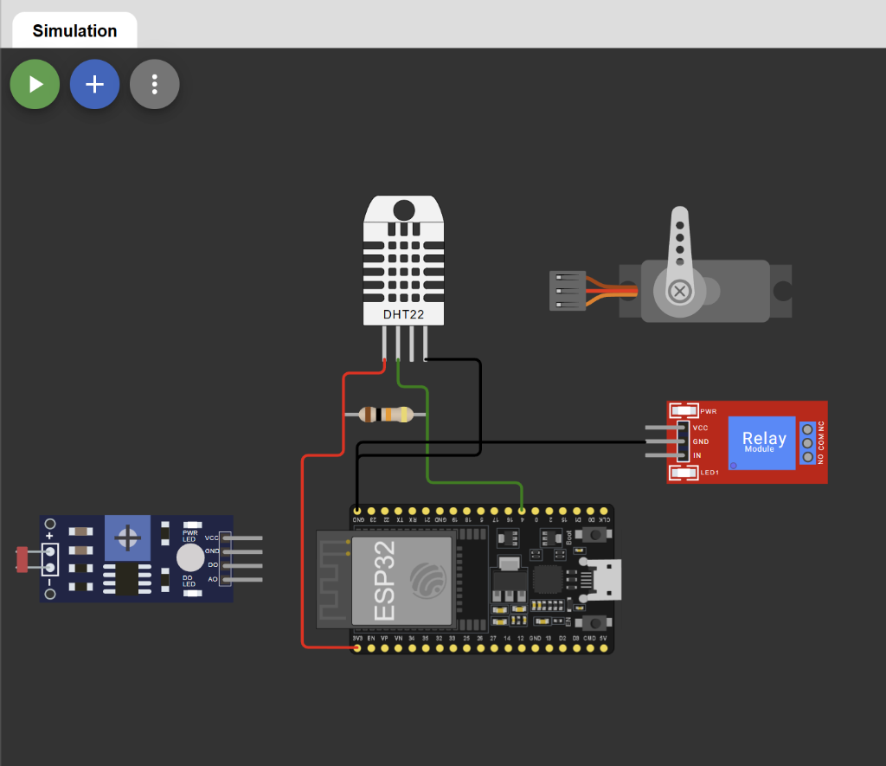
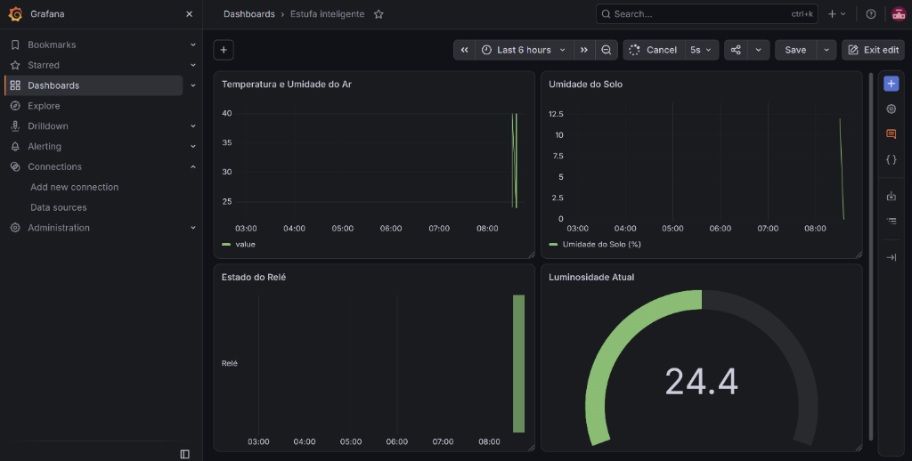

# Estufa inteligente na plataforma FIWARE — Grupo `0412`

**Integrante:** Enrico N. Silva (RA: 24.226.041-2)  
**Repositório GitHub:** <https://github.com/EnricoNSilva/Estufa-inteligente-FIWARE>  
**Simulador de Hardware:** Wokwi (ESP32 com MicroPython — circuito e código em `firmware/`)

## 1. Descrição

A estufa inteligente monitora continuamente quatro variáveis ambientais (temperatura do ar, umidade relativa do ar, umidade do solo e luminosidade) e controla dois atuadores (relé de irrigação/ventilação e servomotor de abertura da janela/cortina). Os dados e comandos trafegam por MQTT até o broker público `broker.hivemq.com` e atravessam uma ponte (*bridge*) no Mosquitto local até a plataforma FIWARE: o IoT Agent JSON traduz as medidas e comandos MQTT para o modelo de contexto NGSI-v2 no Orion Context Broker, que por sua vez aciona subscrições para gravar a série histórica no MySQL (via Cygnus, visualizada no Grafana) e disparar alertas de solo seco para o serviço consumidor externo.

## 2. Arquitetura

```text
               INTERNET                                        MEU COMPUTADOR (Docker)
  ┌──────────────┐        ┌───────────────────┐       ┌───────────────────────────────────────────────────────┐
  │ ESP32/Wokwi  │──MQTT──►                   │ ponte │ Mosquitto :1883 ◄──► IoT Agent JSON ──NGSI-v2──► Orion  │
  │ (estufa)     ◄────────┤ broker.hivemq.com ◄══════►  (só os tópicos       :4041 / :7896    :1026 + MongoDB │
  └──────────────┘  :1883 │  (broker PÚBLICO) │ :1883 │   da API key 0412)                  subscrições │      │
                          └───────────────────┘       │   consumidor :3001 (:3000 int) ◄────────────────┤      │
                                                      │   Cygnus :5050 / :5080 ◄────────────────────────┘      │
                                                      │     └──► MySQL :3307 (:3306 int) ◄── Grafana :3000     │
                                                      └───────────────────────────────────────────────────────┘
```

## 3. Hardware



| Componente      | Pino da ESP32 | Observação |
| --------------- | ------------- | ---------- |
| DHT22           | `GPIO4`       | Sensor digital de temperatura (°C) e umidade relativa do ar (%) |
| Umidade do solo | `GPIO34`      | Entrada analógica (`ADC1_CH6`, `ATTN_11DB`, faixa 0 a 4095) |
| LDR             | `GPIO35`      | Entrada analógica (`ADC1_CH7`, `ATTN_11DB`, faixa 0 a 4095) |
| Relé            | `GPIO26`      | Saída digital (`0` = desligado, `1` = ligado) |
| Servomotor      | `GPIO27`      | PWM a 50 Hz (`duty` de 25 a 125 para ângulo de 0° a 180°) |

**Calibração:** As leituras analógicas do ADC de 12 bits da ESP32 (`0` a `4095`, configuradas com atenuação `ADC.ATTN_11DB` para leitura na faixa de 0 V a 3,3 V) são convertidas linearmente em percentual (`0.0%` a `100.0%`) pela expressão `round((leitura / 4095.0) * 100.0, 1)`, onde `0` corresponde a `0.0%` (solo completamente seco / ambiente escuro) e `4095` corresponde a `100.0%` (solo encharcado / iluminação máxima). Para o servomotor SG90 a 50 Hz (período de 20 ms), o ciclo de trabalho (*duty cycle* de 10 bits, 0–1023) é mapeado linearmente pela fórmula `int(25 + (angulo / 180.0) * 100)`, convertendo a faixa de `0°` a `180°` no intervalo de `duty` de `25` (~0,5 ms) a `125` (~2,4 ms).

## 4. Identificadores

| Item                                    | Valor                                       |
| --------------------------------------- | ------------------------------------------- |
| API key                                 | `0412`                                      |
| Client id da ponte                      | `ponte_0412`                                |
| `fiware-service` / `fiware-servicepath` | `fei` / `/estufa`                           |
| `device_id`                             | `estufa001`                                 |
| Entidade                                | `urn:ngsi-ld:Greenhouse:001` (`Greenhouse`) |
| Client id MQTT da ESP32                 | `esp32_0412_estufa001`                      |

## 5. Modelo de dados

### 5.1 Medidas

| `object_id` (firmware) | Atributo NGSI      | Tipo   | Unidade / faixa |
| ---------------------- | ------------------ | ------ | --------------- |
| `t`                    | `temperature`      | Number | °C              |
| `rh`                   | `relativeHumidity` | Number | %               |
| `sm`                   | `soilMoisture`     | Number | % (0–100)       |
| `lum`                  | `illuminance`      | Number | % (0–100)       |
| `rele`                 | `relayState`       | Number | 0 ou 1          |
| `janela`               | `windowAngle`      | Number | 0–180 (°)       |
| `intervalo`            | `samplingInterval` | Number | s (2–10)        |

Exemplo de payload publicado pela ESP32:
```json
{"t": 24.0, "rh": 40.0, "sm": 100.0, "lum": 24.4, "rele": 1, "janela": 90, "intervalo": 5}
```

### 5.2 Comandos

| Comando       | Valores aceitos | Resposta de sucesso | Respostas de erro |
| ------------- | --------------- | ------------------- | ----------------- |
| `setRelay`    | `0` ou `1`      | `OK`                | `ERRO: valor deve ser 0 ou 1` |
| `setServo`    | `0` a `180`     | `OK`                | `ERRO: valor deve ser de 0 a 180` |
| `setInterval` | `2` a `10` (s)  | `OK`                | `ERRO: intervalo deve ser de 2 a 10 s` |
| `setSending`  | `0` ou `1`      | `OK`                | `ERRO: valor deve ser 0 ou 1` |

### 5.3 Tópicos MQTT

| Sentido   | Tópico                         |
| --------- | ------------------------------ |
| Medidas   | `/json/0412/estufa001/attrs`   |
| Comandos  | `/0412/estufa001/cmd`          |
| Resultado | `/json/0412/estufa001/cmdexe`  |

### 5.4 Ponte com o broker público

| Padrão                         | Direção | Por quê |
| ------------------------------ | ------- | ------- |
| `/json/0412/estufa001/attrs`   | `in`    | Traz as medidas publicadas pela ESP32 no broker público (`broker.hivemq.com`) para o Mosquitto local e o IoT Agent |
| `/json/0412/estufa001/cmdexe`  | `in`    | Traz o resultado de execução dos comandos da ESP32 no broker público para o IoT Agent local |
| `/0412/estufa001/cmd`          | `out`   | Leva os comandos publicados pelo IoT Agent no Mosquitto local para a ESP32 conectada ao broker público |

## 6. Como reproduzir

1. **Clonar o repositório e verificar a ponte**:
   ```bash
   git clone https://github.com/EnricoNSilva/Estufa-inteligente-FIWARE.git
   cd Estufa-inteligente-FIWARE
   ```
   Confirme que o arquivo `plataforma/mosquitto/mosquitto.conf` contém `remote_clientid ponte_0412` e os três tópicos filtrados para a API key `0412`.
2. **Subir os contêineres Docker**:
   ```bash
   cd plataforma
   docker compose up -d
   docker compose ps
   ```
   Aguarde cerca de 20 a 30 segundos até que todos os **9 contêineres** (`fiware-orion`, `db-mongo`, `fiware-iot-agent`, `mosquitto`, `consumidor`, `fiware-cygnus`, `db-mysql`, `grafana` e `lampada-simulada`) apareçam com status `healthy`. Verifique em `docker compose logs mosquitto` a mensagem `Connecting bridge hivemq (broker.hivemq.com:1883)` aparecendo uma única vez.
3. **Testar a ponte MQTT (opcional)**:
   Em um terminal, execute `docker exec -it mosquitto mosquitto_sub -v -t "#"`. Ao publicar no tópico `/json/0412/estufa001/attrs` pelo HiveMQ WebSocket Client, a mensagem deve aparecer imediatamente no terminal local.
4. **Importar a coleção no Postman e provisionar**:
   Importe `postman/Projeto 2.postman_collection.json` no Postman. Confira na aba *Variables* que `apikey` está definida como `0412`. Execute as requisições da **Etapa 1** (`1.1` a `1.6`) e da **Etapa 2** (`2.1` Grupo de serviço e `2.2` Dispositivo da estufa).
5. **Iniciar o firmware na ESP32 / Wokwi**:
   No simulador Wokwi (ou na ESP32 real via Thonny), grave o conteúdo de `firmware/main_esqueleto.py` como `main.py` e inicie a execução. No console serial aparecerá `Wi-Fi ok`, seguido de `Conectado a broker.hivemq.com como esp32_0412_estufa001` e publicações periódicas em `/json/0412/estufa001/attrs` a cada 3 segundos.
6. **Criar as subscrições (Etapa 4)**:
   No Postman, execute `4.1` (Subscrição do histórico para o Cygnus) e `4.4` (Subscrição de alerta de solo seco para o consumidor).
7. **Configurar o Grafana e importar o painel**:
   Acesse `http://localhost:3000` (login `admin` / `admin`). Em *Connections → Data sources*, adicione uma fonte **MySQL** com Host `mysql-db:3306`, Database `fei`, User `grafana` e Password `grafana2026`, clicando em *Save & test*. Em seguida, em *Dashboards → New → Import*, importe o arquivo `plataforma/painel-estufa.json` (também disponível em `grafana/painel-estufa.json`).
8. **Executar a bateria completa de testes no Runner**:
   Com a simulação do Wokwi rodando, abra o **Runner** do Postman na coleção completa (iniciando pela pasta `0 - Recomeçar do zero`). Todas as 42 requisições e 125 asserções (ou 105 no modo gráfico padrão) passarão com 0 falhas.

## 7. Subscrições

| Subscrição          | Condição | Destino | Atributos e formato | Por que assim |
| ------------------- | -------- | ------- | ------------------- | ------------- |
| Histórico           | Mudança em qualquer atributo da entidade `Greenhouse` (`idPattern: ".*"`, `type: "Greenhouse"`) | `http://cygnus:5050/notify` | `temperature`, `relativeHumidity`, `soilMoisture`, `illuminance`, `relayState`, `windowAngle`, `samplingInterval` em formato `normalized` | O Cygnus exige formato `normalized` (para extrair tipos e metadados) e deve receber apenas os 7 atributos de medida para gravar na tabela `estufa` do banco `fei` no MySQL |
| Alerta de solo seco | Mudança em `soilMoisture` com expressão `q: "soilMoisture<30"` na entidade `urn:ngsi-ld:Greenhouse:001` e `throttling: 10` | `http://consumidor:3000/alerta-estufa` | `soilMoisture`, `relayState`, `TimeInstant` em formato `keyValues` | Envia um JSON enxuto (`keyValues`) fácil de processar pelo microserviço consumidor e aplica `throttling: 10` s para evitar inundar o consumidor a cada ciclo de leitura enquanto o solo continuar seco |

## 8. Painel



O painel **Estufa inteligente** foi construído no Grafana conectado ao banco `fei` do MySQL (`mysql-db:3306`) através do usuário somente leitura `grafana` e configurado com atualização automática a cada `5s`. O arquivo JSON exportado está em [`plataforma/painel-estufa.json`](plataforma/painel-estufa.json) (e espelhado em [`grafana/painel-estufa.json`](grafana/painel-estufa.json)). As quatro visualizações configuradas são:

1. **Temperatura e Umidade do Ar** (*Time series*): exibe a evolução temporal conjunta da temperatura (°C) e da umidade relativa do ar (%) no mesmo gráfico, separando as duas curvas pela coluna `attrName AS metric`:
   ```sql
   SELECT 
     CAST(recvTime AS DATETIME(3)) AS time,
     CAST(attrValue AS DECIMAL(6,1)) AS value,
     attrName AS metric
   FROM estufa
   WHERE attrName IN ('temperature', 'relativeHumidity') 
     AND $__timeFilter(recvTime)
   ORDER BY time;
   ```
2. **Umidade do Solo** (*Time series*): exibe a curva histórica da umidade do solo calibrada (0 a 100%) ao longo do intervalo selecionado no painel:
   ```sql
   SELECT 
     CAST(recvTime AS DATETIME(3)) AS time,
     CAST(attrValue AS DECIMAL(6,1)) AS 'Umidade do Solo (%)'
   FROM estufa
   WHERE attrName = 'soilMoisture' 
     AND $__timeFilter(recvTime)
   ORDER BY time;
   ```
3. **Estado do Relé** (*State timeline*): apresenta a linha do tempo discreta do atuador de irrigação/ventilação, convertendo os valores `'1'` e `'0'` armazenados como texto pelo Cygnus nos estados legíveis `'Ligado'` e `'Desligado'`:
   ```sql
   SELECT 
     CAST(recvTime AS DATETIME(3)) AS time,
     IF(attrValue = '1', 'Ligado', 'Desligado') AS 'Relé'
   FROM estufa
   WHERE attrName = 'relayState' 
     AND $__timeFilter(recvTime)
   ORDER BY time;
   ```
4. **Luminosidade Atual** (*Gauge*): mostra o valor instantâneo mais recente do sensor LDR (`illuminance`, em %), ordenando pelo timestamp numérico em milissegundos (`recvTimeTs`) de forma decrescente e limitando a 1 registro:
   ```sql
   SELECT 
     CAST(recvTime AS DATETIME(3)) AS time,
     CAST(attrValue AS DECIMAL(6,1)) AS 'Luminosidade (%)'
   FROM estufa
   WHERE attrName = 'illuminance'
   ORDER BY CAST(recvTimeTs AS UNSIGNED) DESC
   LIMIT 1;
   ```

## 9. Testes

A validação completa do sistema foi realizada executando toda a coleção [`postman/Projeto 2.postman_collection.json`](postman/Projeto%202.postman_collection.json) de ponta a ponta (iniciando pela pasta **0 - Recomeçar do zero**, que apaga subscrições, dispositivo, entidade e grupo de serviço, e passando sequencialmente pelas **Etapas 1, 2, 3 e 4** com a estufa rodando).

- **Arquivo de resultado exportado:** [`postman/CCM520 - Projeto 2 - Estufa na plataforma FIWARE (template).postman_test_run.json`](postman/CCM520%20-%20Projeto%202%20-%20Estufa%20na%20plataforma%20FIWARE%20(template).postman_test_run.json)
- **Resumo da execução:**
  - **Total de requisições executadas:** 42 requisições principais (47 contando sub-requisições assíncronas `pm.sendRequest`)
  - **Testes aprovados (`totalPass`):** **125** (105 asserções diretas nas requisições + 20 sub-asserções dentro dos callbacks de verificação de `2.1` e `2.2`)
  - **Falhas (`totalFail`):** **0**
  - **Tempo total de execução:** ~65 segundos (incluindo os *delays* de espera de comandos MQTT e o teste de 16 segundos do `setSending = 0` na requisição `3.13`).

| Pasta da Coleção | Requisições | O que foi validado nos testes automatizados | Resultado |
| --- | --- | --- | --- |
| **0 - Recomeçar do zero** | `0.1` a `0.4` | Limpeza de todas as subscrições, remoção do dispositivo `estufa001`, da entidade `urn:ngsi-ld:Greenhouse:001` e do grupo `0412` | ✅ Passou |
| **Etapa 1 - Ambiente** | `1.1` a `1.6` | Saúde do Orion (`4.5.0`), IoT Agent (`3.14.0`), Cygnus, Grafana, Consumidor e validação da variável `apikey = 0412` | ✅ Passou |
| **Etapa 2 - Provisionamento** | `2.1` a `2.4` | Criação do grupo (`autoprovision: false`, `Greenhouse`), dispositivo MQTT com 7 medidas (`t`, `rh`, `sm`, `lum`, `rele`, `janela`, `intervalo`), 4 comandos e 2 estáticos, registro no Orion e chegada de medidas | ✅ Passou |
| **Etapa 3 - Firmware e comandos** | `3.1` a `3.15` | Publicação periódica numérica, execução de `setRelay=1`, `setServo=90`, rejeição de comandos inválidos (`setServo=200` e `setInterval=30` preservando estado anterior), mudança para `setInterval=5`, parada (`setSending=0` por 12 s sem novas medidas) e retomada (`setSending=1`) | ✅ Passou |
| **Etapa 4 - Subscrições, histórico e painel** | `4.1` a `4.13` | Subscrição do Cygnus (`normalized`, 7 atributos), subscrição de alerta (`keyValues`, `soilMoisture<30`, `throttling: 10`), disparo de alerta para `/alerta-estufa`, conexão MySQL com usuário `grafana` e validação das 4 visualizações do painel `Estufa inteligente` | ✅ Passou |

## 10. Decisões de projeto e limitações

- **Mapeamento de `object_id` e validação rigorosa no firmware:** Escolhi chaves curtas e intuitivas (`t`, `rh`, `sm`, `lum`, `rele`, `janela`, `intervalo`) para reduzir o tamanho do payload MQTT publicado pela ESP32. No tratamento de comandos (`executar_comando`), implementei validação defensiva com `try/except (ValueError, TypeError)` e bloqueio explícito de valores booleanos (`if isinstance(valor, bool)`), pois em Python/MicroPython `bool` é subclasse de `int` (`int(True) == 1`). Dessa forma, qualquer valor fora de faixa ou de tipo incorreto retorna `"ERRO: <motivo>"` em `/json/0412/estufa001/cmdexe` sem jamais corromper o estado dos atuadores.
- **Atualização imediata de contexto após comandos:** Quando a ESP32 recebe um comando válido e `envio_ativo` está verdadeiro, a função `ao_receber()` publica primeiro o resultado em `cmdexe` e, imediatamente em seguida, chama `publicar_medidas()` e reinicia o temporizador `ultimo_envio = time.ticks_ms()`. Isso garante que o Orion e o Grafana reflitam o novo estado do relé, da janela ou do intervalo instantaneamente (sem esperar até o fim do ciclo atual de amostragem) e evita publicações duplicadas.
- **Laço principal 100% não bloqueante:** O loop principal (`while True`) utiliza apenas `cliente.check_msg()` e comparação temporal com `time.ticks_diff(agora, ultimo_envio) >= intervalo`, sem `time.sleep()` nem `wait_msg()`, garantindo resposta rápida a comandos a qualquer instante, mesmo quando `setSending = 0` pausa o envio periódico de sensores.
- **Ajuste de porta externa do MySQL no Docker Compose:** Como a porta `3306` do Windows já estava ocupada por um serviço local no meu computador, mapeei a porta externa do contêiner `db-mysql` para `"3307:3306"` no `docker-compose.yml`, mantendo a porta interna `3306` intacta na rede Docker para que o Cygnus (`mysql-db:3306`) e o Grafana continuassem se comunicando normalmente.
- **Limitações e o que eu faria diferente em um sistema real:**
  1. **Ausência de segurança no broker público:** O uso do `broker.hivemq.com` na porta `1883` (sem TLS, sem autenticação por usuário/senha e sem ACLs) expõe os tópicos a interceptação, injeção de medidas falsas, envio de comandos não autorizados e desconexão por colisão de `client_id`. Em produção, eu utilizaria um broker MQTT privado (ou em nuvem com TLS na porta `8883`), autenticação individual por dispositivo (certificados X.509 ou credenciais fortes) e listas de controle de acesso (ACL) restritas por tópico.
  2. **Oscilações do gateway Wi-Fi do Wokwi e QoS 0:** Durante o desenvolvimento, o gateway público do Wokwi apresentou instabilidades momentâneas (`ECONNRESET`), e o QoS 0 não garante reentrega. Em um produto real em campo, além de usar QoS 1 para comandos, implementaria reconexão automática com *exponential backoff* e *watchdog timer* (WDT) no microcontrolador.

## 11. Desafios realizados

Foquei na implementação integral e validação completa de todas as etapas obrigatórias do projeto (Etapas 1 a 4, firmware MicroPython, ponte Mosquitto, provisionamento FIWARE, subscrições Cygnus/Consumidor, painel Grafana e 100% dos testes automatizados do Runner passando). Os desafios opcionais bônus (D.1 a D.4) não foram incluídos nesta entrega.

## 12. Uso de ferramentas de IA

Em conformidade com as diretrizes de integridade acadêmica da disciplina CCM520, declaro que utilizei o assistente de IA (Gemini / Antigravity) como ferramenta de apoio ao desenvolvimento para:
- Diagnosticar conflitos de portas locais no Docker (`3306` vs `3307`) e verificar logs dos contêineres FIWARE;
- Depurar o efeito cascata na execução do Runner do Postman quando a pasta `0 - Recomeçar do zero` limpava o ambiente e validar a sintaxe dos corpos JSON das requisições `2.1`, `2.2`, `4.1` e `4.4`;
- Auxiliar na revisão da formatação das consultas SQL do Grafana (`CAST`, `$__timeFilter`) e na revisão textual e organização da documentação no `README.md` e no relatório técnico.

Toda a configuração da API key (`0412`), definição dos `object_id`, testes no Wokwi/HiveMQ/Postman e validação conceitual do funcionamento da arquitetura FIWARE foram conduzidos e verificados por mim.

## 13. Referências

- ALVES, Prof. Rafael Gomes. **Material de aula e Guias da disciplina CCM520 – Internet das Coisas (Aulas 5 a 9 e Projeto 2)**. Centro Universitário FEI, 2026.
- FIWARE Foundation. **FIWARE Orion Context Broker Documentation (NGSI-v2)**. Disponível em: <https://fiware-orion.readthedocs.io/>.
- FIWARE Foundation. **FIWARE IoT Agent for JSON Documentation**. Disponível em: <https://fiware-iotagent-json.readthedocs.io/>.
- FIWARE Foundation. **FIWARE Cygnus Documentation**. Disponível em: <https://fiware-cygnus.readthedocs.io/>.
- Eclipse Foundation. **Eclipse Mosquitto Documentation — Configuring Bridges**. Disponível em: <https://mosquitto.org/man/mosquitto-conf-5.html>.
- HiveMQ. **MQTT Essentials — Shared Subscriptions & Security Fundamentals**. Disponível em: <https://www.hivemq.com/mqtt/>.
- MicroPython. **ESP32 Quickref & `umqtt.simple` Library Documentation**. Disponível em: <https://docs.micropython.org/en/latest/esp32/quickref.html>.
